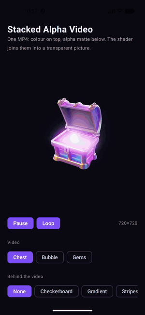
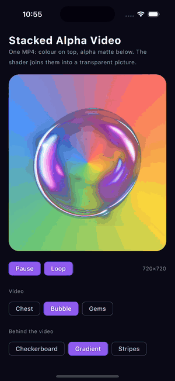
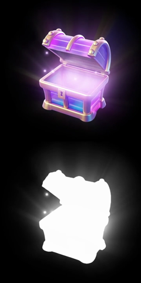
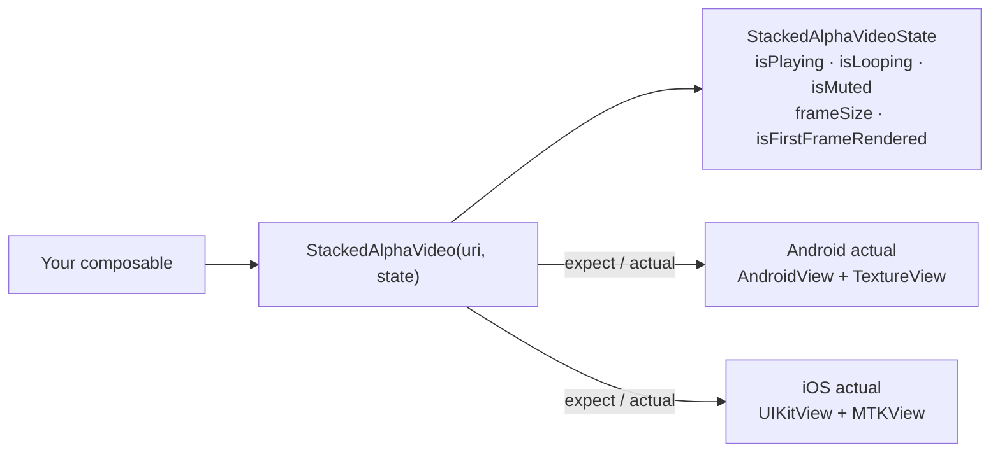
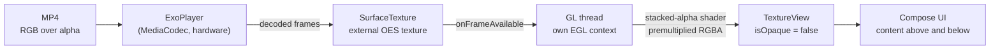
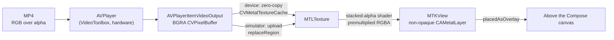

# Stacked Alpha Video

**Transparent video for Compose Multiplatform — Android and iOS — from one ordinary MP4.**

<p align="center">
  
  &nbsp;&nbsp;&nbsp;
  
</p>
<p align="center"><sub>Android emulator (left) and iOS simulator (right). The backdrop moves behind the video, and it shows through every transparent pixel, including the semi-transparent glass of the bubble.</sub></p>

## The problem

You want an animated chest, a glowing bubble or a character to play **over** your UI, with real
transparency. The obvious formats are a poor fit:

| Option | Why it hurts |
|---|---|
| VP9 / WebM with alpha | Android's MediaCodec does not output the alpha plane; on iOS WebM support is limited |
| HEVC with alpha | Apple only |
| GIF / animated WebP | Large files and no hardware decoding; GIF has 1-bit alpha |
| Lottie | Great for vector art, but it can't play a rendered 3D or particle animation |
| PNG sequence | Megabytes of frames, decoded on the CPU |

## The idea

Put the alpha channel **in the picture itself**. Each frame is twice as tall as the visible one:
colour on top and the alpha matte below, as grayscale.

<p align="center">
  
</p>

That is a perfectly normal H.264 video. Every phone decodes it in hardware, the file is small, and
the same asset plays on both platforms. A small fragment shader puts the two halves back together:

```glsl
vec3  rgb   = texture(frame, rgbCoord).rgb;    // top half
float alpha = texture(frame, alphaCoord).g;    // bottom half, green channel
return vec4(rgb * alpha, alpha);               // premultiplied output
```

The matte is read from the green channel because in YUV-encoded video green carries the most luma
precision, so it is the cleanest grayscale after decoding.

## How it works

### Shared API



`commonMain` holds only the composable and its state. Each platform has its own decoder and GPU
pipeline, because that is where the real work happens.

### Android: ExoPlayer → OpenGL ES → TextureView



- ExoPlayer decodes in hardware straight into a `SurfaceTexture`: the frame never touches the CPU.
- A dedicated GL thread with its own EGL context (8-bit alpha config) draws **once per decoded
  frame** instead of running a render loop.
- A `TextureView`, not a `SurfaceView`: a `SurfaceView` is composited in a separate layer behind
  the window, so its alpha shows black. A `TextureView` is drawn as part of the view hierarchy, so
  the video composes with Compose content above and below it.
- Playback pauses on its own when the view is hidden: screen off or app in the background.

### iOS: AVPlayer → Metal → MTKView overlay



- On every vsync the `MTKView` asks the video output for the frame due now. It encodes and
  presents only when a **new** frame arrived, so a paused video costs nothing.
- On a device the pixel buffers are IOSurface-backed and become Metal textures without a copy.
  The simulator hands out plain buffers, which are uploaded instead.
- Compose for iOS normally cuts a hole in its canvas for a UIKit view, which would hide whatever is
  behind the video. With `placedAsOverlay = true` the Metal layer sits above the canvas and its
  transparent pixels reveal the Compose content underneath.

## Usage

```kotlin
@Composable
fun Reward() {
    val state = rememberStackedAlphaVideoState(playing = true, looping = true)

    StackedAlphaVideo(
        uri = Res.getUri("files/chest.mp4"),          // or "https://…", "file://…"
        state = state,
        modifier = Modifier
            .fillMaxWidth()
            .aspectRatio(state.aspectRatio ?: 1f),    // known once the video is loaded
    )

    Button(onClick = { state.togglePlayback() }) {
        Text(if (state.isPlaying) "Pause" else "Play")
    }
}
```

### API

| | |
|---|---|
| `StackedAlphaVideo(uri, modifier, state)` | Plays the video and fills the bounds given by `modifier` |
| `rememberStackedAlphaVideoState(playing, looping, muted)` | Creates the state. `muted` defaults to `true` |
| `state.isPlaying` / `play()` / `pause()` / `togglePlayback()` | Playback. Set to `false` by the player when a non-looping video ends; `play()` restarts it |
| `state.isLooping`, `state.isMuted` | Can be changed while playing |
| `state.frameSize`, `state.aspectRatio` | Size of the **visible** picture (half the source height) |
| `state.isFirstFrameRendered` | `true` once something is on screen; useful to hide a placeholder |

## Making a stacked video

From any video with an alpha channel (for example ProRes 4444 exported from After Effects or
Blender) one ffmpeg command produces the stacked MP4:

```bash
ffmpeg -i input.mov \
  -filter_complex "[0:v]format=rgba,split[color][alpha];[alpha]alphaextract[matte];[color][matte]vstack,format=yuv420p" \
  -c:v libx264 -crf 20 -movflags +faststart -an output.mp4
```

Tips:

- Export **straight** (unpremultiplied) colour; the shader multiplies by alpha itself. Premultiplied
  sources come out with dark edges.
- Width and height must be even. 720×1440 (720×720 visible) is plenty for most UI animations.
- `-movflags +faststart` lets playback start before a remote file finishes downloading.
- H.264 Main profile plays everywhere. HEVC gives smaller files if you don't need older devices.

## Limitations

- **iOS:** the video is an overlay, so Compose content **cannot be drawn on top of the video area**.
  Content behind it is fine. Android has no such restriction.
- One player and one decoder per composable. A long list of simultaneously playing videos will hit
  the device's decoder limit.
- Web and desktop are not supported yet.

## Project structure

```
stacked-alpha-video/   the library (commonMain + androidMain + iosMain)
sample/                demo screen shared by both apps (Compose Multiplatform)
androidApp/            Android host for the sample
iosApp/                Xcode project hosting the sample
```

## Running the sample

- **Android:** `./gradlew :androidApp:installDebug`, or run `androidApp` from Android Studio.
- **iOS:** open `iosApp/iosApp.xcodeproj` in Xcode and run it on a simulator or a device.

Requirements: Android `minSdk 24`; iOS on a device or on the simulator of an Apple-silicon Mac
(`iosArm64`, `iosSimulatorArm64`).

## License

[Apache 2.0](LICENSE)
